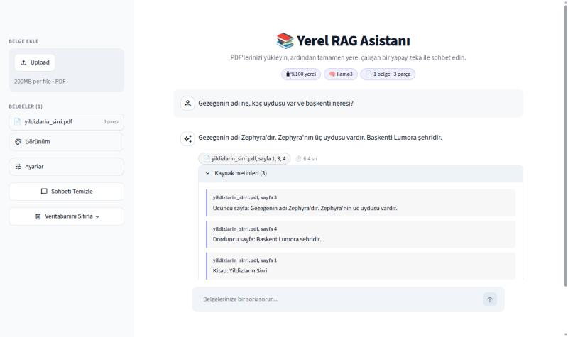
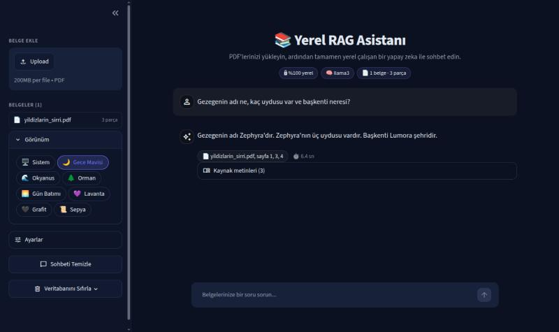
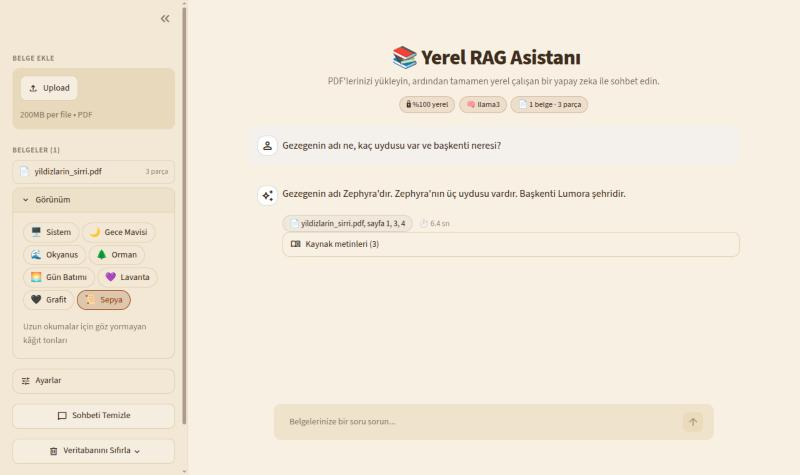
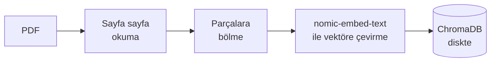
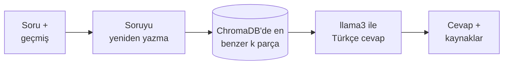

<div align="center">

# 📚 Yerel RAG Asistanı

**PDF'lerinizle sohbet edin — tamamen kendi bilgisayarınızda.**

[](https://github.com/hakanEfeTuysuz/local-rag-assistant/actions/workflows/tests.yml)


[](LICENSE)



</div>

PDF dosyalarınızı okuyup parçalara ayıran, bir vektör veritabanına kaydeden ve ardından sorularınızı **kaynak sayfa ve alıntılarıyla birlikte** cevaplayan bir RAG (Retrieval-Augmented Generation) uygulaması. Embedding ve dil modeli [Ollama](https://ollama.com) ile yerelde çalışır; **belgeleriniz bilgisayarınızdan hiç çıkmaz**, internet sadece modelleri ilk indirirken gerekir.

> 🎯 Bulut API'lerine bağımlı olmadan, veri gizliliğini merkeze alan gerçek dünya yapay zeka çözümleri geliştirmek için hazırlanmış bir **Proof of Concept**; RAG mimarisini sıfırdan kurma ve modern LangChain (1.x) sürümüne taşıma pratiği.

---

## ✨ Öne Çıkanlar

| | |
|---|---|
| 🔒 **Gizlilik önce** | Her şey yerel: modeller Ollama'da, veritabanı diskinizde. Web arayüzü sadece bu bilgisayardan açılır, istatistik gönderimi kapalıdır, yazı tipleri bile internetten yüklenmez. |
| 📖 **Doğrulanabilir cevaplar** | Her cevabın altında kaynak dosya/sayfa rozetleri ve açılır **Kaynak metinleri** bölümü: modelin gördüğü PDF parçalarını okuyup cevabı kendiniz kontrol edersiniz. |
| 💬 **Akıllı sohbet** | Sohbet hafızası + **soru yeniden yazma**: *"Peki onun üniversitesi?"* gibi takip soruları önce anlamlı bir soruya çevrilip öyle aranır. Model bağlamda olmayanı uydurmaz, bulamadığını söyler. Cevaplar her zaman Türkçe. |
| 🎨 **Şık arayüz** | Akış halinde (kelime kelime) gelen cevaplar, örnek sorular, cevap süresi, telefonda da düzgün görünüm ve **8 renk teması**. |
| 🧱 **Sağlam altyapı** | Aynı dosya iki kez eklenmez (içerik özeti/SHA-256), yarıda kalan eklemeler geri alınır, bozuk/parolalı/taranmış PDF'ler anlaşılır Türkçe mesajlarla reddedilir. |
| ✅ **Test edilmiş** | Ollama gerektirmeyen **114 test** (web arayüzü dahil) her `git push`'ta Ubuntu ve Windows'ta çalışır; kod `ruff` ile denetlenir. |

<table>
<tr>
<td width="50%"></td>
<td width="50%"></td>
</tr>
<tr>
<td align="center"><sub>🌙 Gece Mavisi teması ve tema seçici</sub></td>
<td align="center"><sub>📜 Uzun okumalar için Sepya teması</sub></td>
</tr>
</table>

---

## 🚀 Hızlı Başlangıç

**Gereksinimler:** Python 3.10+ ve kurulu, çalışır durumda [Ollama](https://ollama.com).

```bash
# 1) Modelleri indirin (bir kerelik, internet gerekir)
ollama pull nomic-embed-text
ollama pull llama3

# 2) Projeyi kurun
git clone https://github.com/hakanEfeTuysuz/local-rag-assistant.git
cd local-rag-assistant
python -m venv venv
source venv/bin/activate          # Windows: venv\Scripts\activate
pip install -r requirements.txt

# 3) Başlatın (Ollama arka planda çalışıyor olmalı: ollama serve)
streamlit run app.py
```

Tarayıcıda `http://localhost:8501` açılır. Komutu **proje klasöründen** çalıştırın ki `.streamlit/config.toml` ayarları (tema, yerel erişim) devreye girsin.

---

## 🖥️ Kullanım

### Web arayüzü (önerilen)

1. **PDF ekleyin:** Sol panelden bir veya birden fazla PDF seçip **Veritabanına Ekle**'ye basın. Büyük dosyalarda ilerleme çubuğu görünür; eklenen belgeler **Belgeler** listesinde parça sayısıyla durur (telefonda panel sol üstteki `>>` ile açılır).
2. **Soru sorun:** Kutucuğa yazın veya örnek sorulardan birine tıklayın. Cevap akış halinde gelir.
3. **Doğrulayın:** Cevabın altındaki 📄 rozetler kaynak dosya/sayfaları, **Kaynak metinleri** bölümü ise modelin okuduğu PDF parçalarını gösterir. Küçük yerel modeller bazen bilgiyi yanlış aktarabilir; doğrusunu burada hemen görürsünüz.

| Kenar çubuğu | Ne işe yarar |
|---|---|
| **Görünüm** | 8 renk teması: 🖥️ Sistem (açık/koyu otomatik) · 🌙 Gece Mavisi · 🌊 Okyanus · 🌲 Orman · 🌅 Gün Batımı · 💜 Lavanta · 🖤 Grafit · 📜 Sepya. Seçim hatırlanır. |
| **Ayarlar → k** | Her soruda getirilecek parça sayısı. Az sayfalı PDF'lerde 2–4, büyük dosyalarda 6–10 daha isabetli olur; aşırı yüksek değerler bağlam penceresini zorlar. |
| **Sohbeti Temizle** | Sadece sohbet geçmişini siler, belgeler kalır. |
| **Veritabanını Sıfırla** | Onay istedikten sonra tüm belgeleri ve sohbeti siler. |

> 🔒 Uygulama varsayılan olarak **sadece bu bilgisayardan** açılır. Aynı ağdaki başka bir cihazdan bilerek erişmek için `streamlit run app.py --server.address 0.0.0.0` kullanabilirsiniz; bu durumda ağdaki herkesin belgelerinize soru sorabileceğini unutmayın.

### Terminal (CLI)

Otomasyon veya arayüzsüz kullanım için. CLI, web arayüzünden **ayrı** bir veritabanı (`chroma_db/`) kullanır.

```bash
# PDF'leri ekleyin (zaten ekli olanlar otomatik atlanır)
python rag_motoru.py --pdf rapor.pdf sunum.pdf

# Tek seferlik soru
python soru_cevap.py -s "Bu raporun ana sonuçları neler?"

# Sohbet modu (geçmişi hatırlar; çıkmak için q)
python soru_cevap.py
```

```
🤖 ASİSTANIN CEVABI:
--------------------------------------------------
Raporun ana sonuçları şunlardır: ...
--------------------------------------------------

📚 Kaynaklar:
  - rapor.pdf, sayfa 3, 7
```

<details>
<summary><b>CLI ayrıntıları</b></summary>

- `cv.pdf`, `./cv.pdf` ve tam yol aynı dosya sayılır; içerik özeti de karşılaştırıldığı için başka klasördeki aynı dosya da atlanır.
- Birden fazla dosyadan birinde hata olursa (bulunamadı, bozuk PDF) diğerleri yine işlenir; sonda başarısızlar listelenir ve script `1` çıkış koduyla biter. Her şey yolundaysa çıkış kodu `0`'dır.
- Sohbet modunda tek bir soruda hata olursa (örn. Ollama bir anlığına yanıt vermezse) sohbet kapanmaz, geçmiş kaybolmaz. `q`, `quit`, `exit`, `çık` veya `Ctrl+C` ile çıkılır.
- CLI veritabanını sıfırlamak için: `rm -rf chroma_db` (Windows: `rmdir /s /q chroma_db`).

</details>

---

## ⚙️ Nasıl Çalışır?

**📥 Belge ekleme**



**💬 Soru-cevap**



1. **Okuma ve bölme:** PDF sayfa sayfa okunur (bozuk tek tük sayfalar atlanır), metin `RecursiveCharacterTextSplitter` ile örtüşen parçalara bölünür.
2. **Saklama:** Parçalar gruplar halinde vektöre çevrilip Chroma'ya yazılır. Her parçada dosya yolu, sayfa numarası ve içerik özeti saklanır; parça kimlikleri bu özetten türetildiği için kopya oluşmaz. Ekleme yarıda kesilirse o dosyanın parçaları geri silinir.
3. **Arama:** Sohbet geçmişi varsa soru önce modele "geçmişi görmeyen birinin de anlayacağı" bir soruya çevrilir (*"Onun üniversitesi?"* → *"Hakan'ın okuduğu üniversite neresi?"*), sonra en benzer `k` parça bulunur.
4. **Cevap:** Parçalar, geçmiş ve soru `ChatOllama` ile modele gider. Sistem promptu cevabın her zaman Türkçe olmasını, bağlam soruyla örtüşmüyorsa bunun açıkça söylenmesini ve bilinmeyenin uydurulmamasını ister.

Web arayüzü ve CLI aynı RAG çekirdeğini ([`rag_zinciri.py`](rag_zinciri.py)) kullanır; zincir LangChain'in LCEL yapısıyla kurulur (`create_history_aware_retriever` → `create_stuff_documents_chain` → `create_retrieval_chain`).

---

## 🔧 Ayarlar

Tüm ayarlar [`config.py`](config.py) içindedir ve koda dokunmadan **ortam değişkeniyle** değiştirilebilir:

```bash
RAG_LLM_MODEL=mistral RAG_RETRIEVER_K=6 streamlit run app.py
```

| Ayar | Varsayılan | Ortam değişkeni | Açıklama |
|---|---|---|---|
| `EMBED_MODEL` | `nomic-embed-text` | `RAG_EMBED_MODEL` | Embedding modeli |
| `LLM_MODEL` | `llama3` | `RAG_LLM_MODEL` | Sohbet modeli |
| `RETRIEVER_K` | `4` | `RAG_RETRIEVER_K` | Her soruda getirilecek parça sayısı (web'de kaydırıcının varsayılanı) |
| `NUM_CTX` | `8192` | `RAG_NUM_CTX` | Modelin bağlam penceresi (token); yüksek `k` değerlerinde büyütün |
| `CHUNK_SIZE` / `CHUNK_OVERLAP` | `1000` / `200` | `RAG_CHUNK_SIZE` / `RAG_CHUNK_OVERLAP` | Parça boyutu ve örtüşmesi (karakter) |
| `GECMIS_MAX_MESAJ` | `10` | `RAG_GECMIS_MAX_MESAJ` | Modele gönderilecek en fazla geçmiş mesaj (1 soru + 1 cevap = 2) |
| `EMBED_PARTI_BOYUTU` | `64` | `RAG_EMBED_PARTI_BOYUTU` | Embedding'e tek seferde gönderilen parça sayısı |
| `DB_DIR` / `WEB_DB_DIR` | `chroma_db` / `web_chroma_db` | `RAG_DB_DIR` / `RAG_WEB_DB_DIR` | CLI ve web veritabanı klasörleri |
| `UPLOAD_KLASORU` | `yuklenen_pdfler` | `RAG_UPLOAD_KLASORU` | Web'den yüklenen PDF'lerin kopyaları |
| `TEMA_DOSYASI` | `.streamlit/secilen_tema.txt` | `RAG_TEMA_DOSYASI` | Web'de seçilen renk teması |

Göreli yollar, komutun nereden çalıştırıldığından bağımsız olarak proje klasörüne göre çözülür. Ollama başka bir makinede çalışıyorsa Ollama'nın kendi `OLLAMA_HOST` değişkenini kullanın (örn. `OLLAMA_HOST=http://192.168.1.10:11434`).

---

## 🧪 Testler

```bash
./testleri_calistir.sh            # Linux/Mac
python testleri_calistir.py       # Windows dahil her platform
```

Testlerin hiçbiri Ollama gerektirmez: deterministik sahte embedding, sahte sohbet modeli ve bellekte çalışan Chroma kullanılır. Böylece CI'da bile **RAG zinciri ve web arayüzü uçtan uca** test edilir. Her `git push`'ta GitHub Actions kodu önce `ruff` ile denetler, sonra testleri temiz **Ubuntu ve Windows** ortamlarında çalıştırır.

<details>
<summary><b>Hangi dosya neyi test ediyor?</b></summary>

| Dosya | Kapsam |
|---|---|
| `test_rag_motoru.py` | PDF okuma/parçalama, bozuk/metinsiz/parolalı/olmayan PDF'ler, okunamayan sayfanın atlanması, tekrar-ekleme kontrolü, gruplu ekleme + ilerleme, yarıda kalan eklemenin geri alınması, dosya adı temizleme, CLI çıkış kodları |
| `test_rag_zinciri.py` | Kaynak listeleme ve alıntılar, geçmiş kırpma, takip sorusunun yeniden yazılıp öyle aranması, akış çıktısı, gerçek Chroma ile zincir |
| `test_soru_cevap.py` | Hata sonrası sohbetin devam etmesi, kırpılmış geçmiş, veritabanı yokken anlaşılır hata |
| `test_app.py` | Web arayüzü: yükleme, soru-cevap, kaynaklar, örnek sorular, boş soru, kötü niyetli/çok uzun dosya adları, sohbeti temizleme, onaylı sıfırlama, tema seçimi |
| `test_temalar.py` | Temaların eksiksizliği, WCAG kontrast oranları (okunabilirlik), tema geçişi ve kaydı |
| `test_config.py` | Varsayılanlar, ortam değişkenleri, geçersiz değerlerin anlaşılır hatası |

Test scriptleri, pytest'in sistemdeki ilgisiz paketleri (örn. ROS2) eklenti sanıp yüklemesini engeller. Kod denetimi için: `pip install ruff==0.17.3 && ruff check .`

</details>

---

## 🗂️ Proje Yapısı

```
├── app.py                 # Streamlit web arayüzü
├── rag_zinciri.py         # Ortak RAG çekirdeği: modeller, promptlar, zincir, kaynaklar, hata sınıfları
├── rag_motoru.py          # PDF okuma/parçalama/ekleme + CLI
├── soru_cevap.py          # Terminalden soru-cevap / sohbet modu
├── temalar.py             # Web arayüzünün renk temaları
├── config.py              # Tüm ayarlar (ortam değişkenleriyle değiştirilebilir)
├── tests/                 # 114 pytest testi (Ollama gerektirmez)
├── docs/                  # README ekran görüntüleri
├── .streamlit/config.toml # Varsayılan tema, sadece yerel erişim, istatistik kapalı
├── requirements.in        # Doğrudan kullanılan paketler (kısa liste)
├── requirements.txt       # Test edilmiş, sabitlenmiş tam bağımlılık listesi
├── ruff.toml / pytest.ini # Lint ve test ayarları
└── .github/workflows/     # CI: lint + Ubuntu/Windows testleri
```

`chroma_db/`, `web_chroma_db/`, `yuklenen_pdfler/` ve tema seçimi çalışırken otomatik oluşur ve repoya dahil edilmez.

<details>
<summary><b>Bağımlılıklar hakkında</b></summary>

`requirements.in` projenin doğrudan kullandığı paketleri listeler (`langchain-core`, `langchain-classic`, `langchain-text-splitters`, `langchain-ollama`, `langchain-chroma`, `chromadb`, `pypdf`, `streamlit`, `pytest`). `requirements.txt` ise bunların tüm alt bağımlılıklarıyla test edilmiş sürümlere sabitlenmiş halidir (örn. `kubernetes`, `chromadb`'nin alt bağımlılığıdır). Yeni bir paket eklerken önce `requirements.in`'e yazın, temiz bir venv'de kurun ve `pip freeze --local > requirements.txt` ile yeniden üretin.

</details>

---

## ❗ Sorun Giderme

<details>
<summary><b>Sık karşılaşılan durumlar ve çözümleri</b></summary>

| Mesaj / Durum | Sebep | Çözüm |
|---|---|---|
| `'...' modeli yüklenemedi. Ollama çalışıyor mu?` | Ollama kapalı veya model indirilmemiş | `ollama serve` çalıştırın, mesajdaki `ollama pull ...` komutuyla modeli indirin; web'de sayfayı yenileyin |
| `Vektör veritabanı bulunamadı!` / `veritabanı boş!` | CLI'da henüz PDF eklenmemiş | Önce `python rag_motoru.py --pdf dosya.pdf` |
| `... içinden hiç metin çıkarılamadı` | Taranmış (görsel) PDF; proje OCR yapmaz | PDF'i önce bir OCR aracıyla (örn. `ocrmypdf`) metinli hale getirin |
| `... parola korumalı` | PDF açılış parolası istiyor | Parolayı kaldırıp tekrar deneyin (sadece kopyalama/yazdırma kısıtlı PDF'ler sorunsuz okunur) |
| `... PDF olarak okunamadı` | Dosya bozuk veya PDF değil | Dosyayı bir PDF okuyucuyla açıp kontrol edin |
| `'...' adında, içeriği farklı bir dosya zaten ekli` | Aynı isimli farklı bir dosya eklenmiş | Yeni dosyayı yeniden adlandırın |
| Başka bir cihazdan bağlanılamıyor | Güvenlik için sadece `localhost` dinlenir | `streamlit run app.py --server.address 0.0.0.0` (ağdaki herkes erişebilir) |
| `k` yüksekken cevaplar kötüleşiyor | Bağlam penceresi (`NUM_CTX`) aşılıyor | `RAG_NUM_CTX=16384` gibi büyütün veya `k`'yı düşürün |
| Model ilgisiz bir bağlamı doğruymuş gibi anlatıyor | Anlamsal olarak yakın ama konusu farklı parça gelmiş | Konu uyumu kontrolü bunu büyük ölçüde engeller; `k`'yı değiştirip tekrar deneyin, **Kaynak metinleri**'ne bakın |
| Türkçe soruya İngilizce cevap / çok kısa sorularda tuhaf cevap | Bağlam İngilizce veya soru çok belirsiz | Daha spesifik sorular sorun |
| Büyük PDF'lerde ekleme uzun sürüyor | Embedding yerel donanımda hesaplanıyor | İlerleme çubuğundan takip edin; yarıda kalırsa tekrar eklemeniz yeterli |
| Cevaplar çok yavaş | Makine kaynakları yetersiz | Daha küçük bir model deneyin (`RAG_LLM_MODEL=...`) |
| `pytest` ilgisiz eklenti hataları veriyor (`PluginValidationError`, `lark`) | Sistem paketleri (örn. ROS2) eklenti sanılıyor | `pytest` yerine `./testleri_calistir.sh` / `python testleri_calistir.py` kullanın |
| `No module named 'langchain.chains'` | LangChain 1.x'te zincirler `langchain_classic`'e taşındı | `pip install -r requirements.txt` |

</details>

---

## 📌 Bilinen Sınırlamalar ve Yol Haritası

- **Arama tamamen anlamsaldır:** Özel isim, kod veya madde numarası gibi birebir eşleşme gereken sorularda, ilgili cümle konusu farklı uzun bir paragrafın içindeyse bulunamayabilir (300 sayfalık sentetik bir testte bu yüzden bulunamayan cümle için model uydurmadı, bulamadığını söyledi). Soruyu belgedeki ifadelere yakın kurmak veya `k`'yı artırmak yardımcı olur.
- **OCR yoktur:** Taranmış PDF'ler anlaşılır bir hatayla reddedilir.
- **Küçük modeller hata yapabilir:** Soru yeniden yazma ve cevaplar yerel modelin kalitesine bağlıdır; kritik kullanımlarda **Kaynak metinleri** ile kontrol edin. Takip sorularında ek bir model çağrısı yapıldığı için biraz daha yavaştır.
- **Hafıza sınırlıdır:** Modele son `GECMIS_MAX_MESAJ` mesaj gönderilir; çok uzun sohbetlerde en eski kısım unutulur.
- **Testler cevap kalitesini ölçmez:** Zincir sahte modellerle test edilir; gerçek modelin doğruluğu otomatik ölçülmez.

**Sıradaki adımlar:** anlamsal + kelime araması (hibrit arama), OCR desteği, cevap kalitesini ölçen küçük bir değerlendirme seti.

---

## 📄 Lisans

[MIT](LICENSE) © 2026 Hakan Efe Tüysüz
